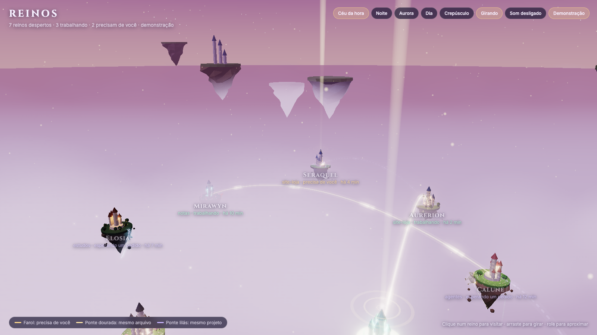
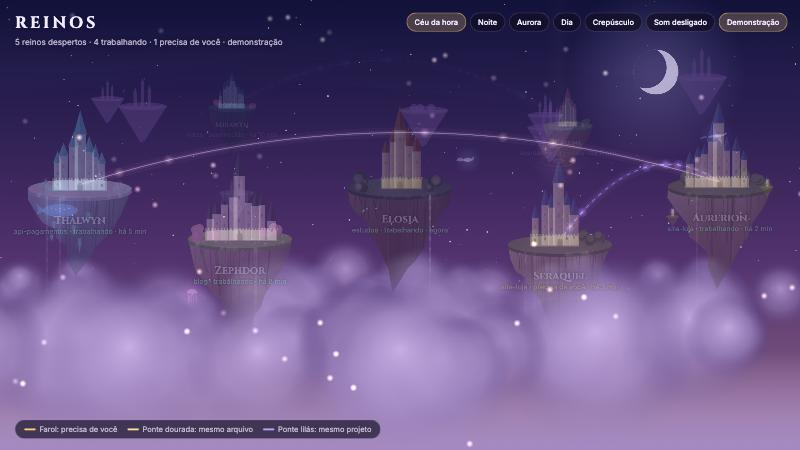

# Reinos

Painel ao vivo que transforma cada sessão do [Claude Code](https://claude.com/claude-code) em um **reino mágico flutuante**. Um hook registra o que cada sessão faz como uma nota num vault do [Obsidian](https://obsidian.md), e um pequeno servidor Node transmite essas notas em tempo real para uma cena 3D no navegador.



<p align="center">
  
  <br>
  <em>Versão 2D leve (<code>/2d.html</code>). As capturas usam o modo demonstração, com reinos fictícios.</em>
</p>

## Funcionalidades

- **Um reino por sessão**: nome, bioma e guardião (dragão, pégaso, fênix…) gerados de forma determinística a partir da sessão e do projeto.
- **Status ao vivo**: `trabalhando`, `chamando` (o farol acende quando a sessão precisa de você), `repousando` e `adormecido`.
- **Cidade que reflete o trabalho**: os prédios de cada ilha espelham as ferramentas usadas e os arquivos tocados.
- **Pontes entre reinos**: douradas quando duas sessões mexem no mesmo arquivo, lilás quando são do mesmo projeto.
- **Emissários**: subagentes aparecem voando ao redor do reino.
- **Crônica**: as últimas ações de cada sessão, legíveis tanto no painel quanto no Obsidian.
- **Céu configurável** (hora real, noite, aurora, dia, crepúsculo), sino sonoro opcional e **modo demonstração** (`?demo`).
- **Versão 2D** leve em `/2d.html`.
- **Integração com o Obsidian**: as notas têm propriedades, links `[[Outro reino]]` que aparecem no grafo e um botão para abrir a nota.

## Tecnologias

- Node.js (ES Modules, sem dependências em produção): `node:http`, `fs.watch` e Server-Sent Events.
- [Three.js](https://threejs.org) 0.160 via CDN (import map) para a cena 3D; Canvas 2D para a versão leve.
- Obsidian como armazenamento: notas Markdown com frontmatter.
- Hooks do Claude Code.
- Prettier e ESLint no desenvolvimento.

## Estrutura de pastas

```
.
├── server.mjs          # servidor HTTP: API, SSE (/eventos) e arquivos estáticos
├── lib/
│   └── reinos.mjs      # nomes, biomas, guardiões e leitura/escrita das notas
├── hooks/
│   └── reino.mjs       # hook do Claude Code: atualiza a nota do reino a cada evento
├── public/
│   ├── index.html      # painel 3D
│   ├── mundo.js        # cena, ilhas, céu, pontes e interface
│   ├── cidade.js       # cidade construída a partir da atividade da sessão
│   ├── guardioes.js    # modelos das criaturas guardiãs
│   └── 2d.html         # versão 2D
├── docs/img/           # capturas de tela do README
├── vault/              # vault do Obsidian (as notas em vault/Reinos/ não são versionadas)
└── vault.example/      # vault de exemplo com reinos fictícios
```

> As notas em `vault/Reinos/` são geradas pelo hook e contêm IDs de sessão, caminhos locais e o texto dos seus pedidos. Por isso ficam fora do Git. Use `vault.example/` para ver o formato.

## Como instalar e rodar

Requer **Node.js 22.9 ou mais recente**.

```bash
npm install
cp .env.example .env   # opcional
npm start
```

Abra <http://localhost:4747>. Sem nenhuma sessão registrada, clique em **Ver demonstração** ou acesse <http://localhost:4747/?demo>.

### Variáveis de ambiente (`.env`)

| Variável       | Padrão    | Descrição                                                                    |
| -------------- | --------- | ---------------------------------------------------------------------------- |
| `PORT`         | `4747`    | Porta do servidor local.                                                     |
| `REINOS_COFRE` | `./vault` | Pasta do vault do Obsidian. Use `./vault.example` para ver dados de exemplo. |

O `npm start` carrega o `.env` automaticamente quando ele existe (`node --env-file-if-exists`). O servidor escuta apenas em `127.0.0.1`.

> Os reinos de exemplo ficam "adormecidos" depois de algumas horas sem atualização, porque o status é calculado a partir do campo `atualizado` das notas.

### Ligar o hook no Claude Code

Adicione o hook em `~/.claude/settings.json` (ajuste o caminho do projeto) para os eventos `SessionStart`, `UserPromptSubmit`, `PreToolUse`, `PostToolUse`, `Notification`, `Stop` e `SessionEnd`:

```json
{
  "hooks": {
    "UserPromptSubmit": [{ "hooks": [{ "type": "command", "command": "node /caminho/para/reinos/hooks/reino.mjs" }] }]
  }
}
```

Repita o mesmo bloco para cada evento. O hook nunca bloqueia o Claude: qualquer erro é ignorado e ele sempre sai com código 0. Se você definir `REINOS_COFRE`, defina também no ambiente do hook.

## Scripts

| Comando                | O que faz                                   |
| ---------------------- | ------------------------------------------- |
| `npm start`            | Sobe o servidor em `http://localhost:4747`. |
| `npm run format`       | Formata o projeto com Prettier.             |
| `npm run format:check` | Verifica a formatação sem alterar arquivos. |
| `npm run lint`         | Roda o ESLint.                              |

## Próximos passos

- [ ] Testes automatizados para `lib/reinos.mjs` (nomes, frontmatter) e para a API.
- [ ] Script de instalação do hook em `~/.claude/settings.json`.
- [ ] Lint também dos scripts inline do HTML.
- [ ] Servir o Three.js localmente para funcionar offline.
- [ ] Mais biomas, guardiões e tipos de prédio.
- [ ] Histórico: linha do tempo dos reinos adormecidos.

## Licença

[MIT](LICENSE)
